# ParkEasy - Parking Slot Booking

A MERN stack capstone project where drivers find a parking lot, reserve a slot for a time window and see availability change live, while lot managers run their lots and admins oversee the platform.

**Student:** Aark Bharti | **Roll No.:** 2501730503 | **Programme:** B.Tech CSE (AI & ML), Section G
**Course:** Web Development (MERN capstone) | **Project:** #35 ParkEasy - Parking Slot Booking

**Live demo:** add your deployed frontend and backend links here (see [Deployment](#deployment)).

---

## What it does

| Role | Can do |
|---|---|
| **Driver** | Search lots, see free slots for any time window, reserve a slot with a vehicle number, cancel, check in on arrival, check out and pay the calculated fee |
| **Lot manager** | Create and edit lots, add slots in bulk, see and handle bookings for their own lots (check in, check out, cancel), view occupancy, revenue and peak-hour reports |
| **Admin** | Platform statistics, search users, block or unblock accounts, change a user's role, and access every lot and report |

Highlights:

- **No double booking.** A slot cannot be reserved for overlapping times. The check runs under a per-slot lock, and a test fires six simultaneous requests for the same slot and confirms exactly one wins.
- **Live availability.** Socket.IO pushes fresh free-slot counts to the lot list and the slot grid whenever someone books, cancels, checks in or checks out.
- **Fee on exit.** The fee is calculated from the real entry and exit time, per started hour, minimum one hour.
- **Secure auth.** bcrypt password hashing, short-lived JWT access tokens, rotating refresh tokens stored only as hashes, and reuse detection that ends all sessions.

## Tech stack

| Layer | Libraries |
|---|---|
| Backend | express, mongoose, dotenv, bcrypt, jsonwebtoken, socket.io |
| Frontend | react, react-router-dom, Fetch API, Context API, socket.io-client (Vite is used only as the build tool) |
| Database | MongoDB |
| Testing | Postman collection (run with Newman), plus a Node end-to-end script |

No UI library, chart library or other extra packages are used. The charts are plain CSS bars.

## Requirement checklist

| Mandatory requirement | Where it is met |
|---|---|
| MVC structure | `backend/src/` has `models`, `controllers`, `routes`, `middleware`, `config`, plus `services`, `utils` and `sockets` |
| `.env`, never committed | `.env` is in `.gitignore`; `backend/.env.example` and `frontend/.env.example` list every variable |
| Register / login, bcrypt, JWT access + refresh | `authController.js`, `models/User.js`, `utils/tokens.js` |
| Protected route and RBAC route | `middleware/auth.js` (`protect`, `authorize`); for example `/api/auth/me`, `/api/reports/*`, `/api/admin/*` |
| Mongoose schemas, validation, relationships | `models/` (User, Lot, Slot, Reservation) with `ref` links, see the ER diagram |
| Aggregation pipeline and index | Reports, availability counts and admin stats use aggregation; indexes listed below |
| Centralised error handling | `middleware/error.js` with `AppError`; maps validation, cast, duplicate-key and JWT errors to proper status codes |
| REST API tested with Postman | `postman/ParkEasy.postman_collection.json` (42 requests, 57 assertions) |
| React with routing, controlled forms, Context, protected pages | `frontend/src`: `react-router-dom` routes, `AuthContext`, `SocketContext`, `ProtectedRoute` |
| Advanced feature: Socket.IO | Live availability (`backend/src/sockets`, `LotDetail.jsx`, `Lots.jsx`) |

## Project structure

```
ParkEasy/
|-- backend/
|   |-- src/
|   |   |-- config/db.js              MongoDB connection
|   |   |-- models/                   User, Lot, Slot, Reservation
|   |   |-- controllers/              auth, lot (+slots), reservation, report, admin
|   |   |-- routes/                   one router per resource
|   |   |-- middleware/               auth (protect/authorize), error, cors
|   |   |-- services/availability.js  "is this slot taken for this window" logic
|   |   |-- sockets/index.js          Socket.IO server with JWT handshake
|   |   |-- utils/                    AppError, asyncHandler, tokens, fee, lock, events, validate
|   |   |-- app.js / server.js
|   |-- scripts/                      seed.js, demo-data.js, api-test.js
|-- frontend/
|   |-- src/
|       |-- api/client.js             fetch wrapper with automatic token refresh
|       |-- context/                  AuthContext, SocketContext
|       |-- components/               Navbar, ProtectedRoute, shared UI
|       |-- pages/                    Login, Register, Lots, LotDetail, MyBookings, Manager, Admin
|-- postman/ParkEasy.postman_collection.json
|-- docs/                             ER diagram source and screenshots
```

## Database design

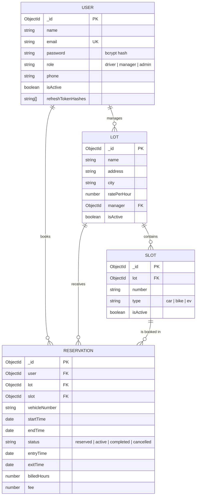

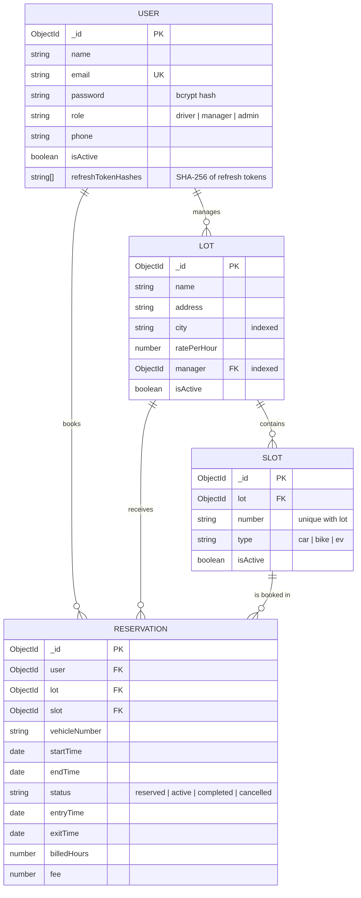

**Indexes**

| Collection | Index | Why |
|---|---|---|
| User | `email` (unique) | One account per email, fast login |
| Lot | `city`, `manager` | City search and "my lots" |
| Slot | `{ lot, number }` (unique) | Slot numbers are unique inside a lot |
| Reservation | `{ slot, status, startTime, endTime }` | The overlap check on every booking |
| Reservation | `{ user, createdAt }` | "My bookings" |
| Reservation | `{ lot, status, exitTime }` | Manager lists and revenue reports |

**Aggregation pipelines**

| Where | What it computes |
|---|---|
| `GET /api/reports/occupancy` | `$group` + `$cond` + `$lookup`: bookings, cancellations, booked hours per lot, then occupancy % |
| `GET /api/reports/revenue` | `$facet` with three branches: totals, revenue per day (`$dateToString`), revenue per lot (`$lookup`) |
| `GET /api/reports/peak-hours` | `$group` by `$hour` of the start time |
| `GET /api/admin/stats` | Users by role, bookings by status, total revenue |
| Lot cards | Total and busy slots per lot, used for live availability |

## Getting started

You need Node.js 18+ and MongoDB (local, or a free MongoDB Atlas cluster).

**1. Backend**

```bash
cd backend
npm install
cp .env.example .env        # then set the two JWT secrets and MONGO_URI
npm run seed                # creates admin, manager, driver and 3 demo lots
node scripts/demo-data.js   # optional: fills reports with sample bookings
npm run dev                 # API on http://localhost:5000
```

**2. Frontend** (in a second terminal)

```bash
cd frontend
npm install
cp .env.example .env
npm run dev                 # app on http://localhost:5173
```

**Demo accounts** (created by the seed script)

| Role | Email | Password |
|---|---|---|
| Admin | admin@parkeasy.com | Admin@123 |
| Manager | manager@parkeasy.com | Manager@123 |
| Driver | driver@parkeasy.com | Driver@123 |

Change these before any real deployment.

### Environment variables

**backend/.env**

| Variable | Purpose |
|---|---|
| `PORT` | API port (default 5000) |
| `MONGO_URI` | MongoDB connection string |
| `CLIENT_URL` | Allowed frontend origin(s), comma separated (CORS and Socket.IO) |
| `JWT_ACCESS_SECRET` | Secret for access tokens |
| `JWT_REFRESH_SECRET` | A different secret for refresh tokens |
| `JWT_ACCESS_EXPIRES` | Access token lifetime, for example `15m` |
| `JWT_REFRESH_EXPIRES` | Refresh token lifetime, for example `7d` |
| `BCRYPT_ROUNDS` | bcrypt cost factor (default 10) |
| `ADMIN_EMAIL`, `ADMIN_PASSWORD` | Used only by the seed script |

**frontend/.env**

| Variable | Purpose |
|---|---|
| `VITE_API_URL` | Backend base URL without `/api`, for example `http://localhost:5000` |

## API documentation

All responses are JSON. Errors look like `{ "success": false, "message": "...", "details": [...] }`. Protected routes need `Authorization: Bearer <accessToken>`.

### Auth

| Method | Endpoint | Access | Notes |
|---|---|---|---|
| POST | `/api/auth/register` | Public | Body: `name, email, password, phone?, role?` (`driver` or `manager`). Returns user and token pair |
| POST | `/api/auth/login` | Public | Body: `email, password` |
| POST | `/api/auth/refresh` | Public | Body: `refreshToken`. Rotates the pair; a reused token ends all sessions |
| POST | `/api/auth/logout` | Public | Body: `refreshToken`. Revokes it |
| GET | `/api/auth/me` | Any logged-in user | Current user |

### Lots and slots

| Method | Endpoint | Access | Notes |
|---|---|---|---|
| GET | `/api/lots` | Any logged-in user | Query: `q`, `city`, `page`, `limit`. Each lot includes `availability` |
| GET | `/api/lots/mine` | Manager, admin | Own lots (admin: all) |
| POST | `/api/lots` | Manager, admin | Body: `name, address, city, ratePerHour` |
| GET | `/api/lots/:id` | Any logged-in user | One lot with availability |
| PUT | `/api/lots/:id` | Owner, admin | Edit fields or `isActive` |
| DELETE | `/api/lots/:id` | Owner, admin | Blocked while bookings are open |
| GET | `/api/lots/:id/slots` | Any logged-in user | Query: `start`, `end`, `type`. Each slot has `available` for that window |
| POST | `/api/lots/:id/slots` | Owner, admin | One slot (`number`) or many (`prefix`, `count`, `type`) |
| DELETE | `/api/slots/:id` | Owner, admin | Blocked while bookings are open |

### Reservations

| Method | Endpoint | Access | Notes |
|---|---|---|---|
| POST | `/api/reservations` | Driver | Body: `slotId, vehicleNumber, startTime, endTime` |
| GET | `/api/reservations/mine` | Any logged-in user | Query: `status`, `page`, `limit` |
| GET | `/api/reservations` | Manager, admin | Bookings in own lots. Query: `lotId`, `status`, `date`, `page` |
| GET | `/api/reservations/:id` | Owner, lot manager, admin | |
| PATCH | `/api/reservations/:id/cancel` | Owner, lot manager, admin | Only `reserved` bookings |
| PATCH | `/api/reservations/:id/checkin` | Owner, lot manager, admin | From 15 minutes before the start until the end |
| PATCH | `/api/reservations/:id/checkout` | Owner, lot manager, admin | Calculates and stores the fee |

### Reports and admin

| Method | Endpoint | Access | Notes |
|---|---|---|---|
| GET | `/api/reports/occupancy` | Manager, admin | Query: `from`, `to`, `lotId` |
| GET | `/api/reports/revenue` | Manager, admin | Totals, per day, per lot |
| GET | `/api/reports/peak-hours` | Manager, admin | 24 hourly buckets |
| GET | `/api/admin/stats` | Admin | Platform numbers |
| GET | `/api/admin/users` | Admin | Query: `q`, `role`, `page` |
| PATCH | `/api/admin/users/:id/active` | Admin | Body: `isActive` (block or unblock) |
| PATCH | `/api/admin/users/:id/role` | Admin | Body: `role` (`driver` or `manager`) |

### Socket.IO

Connect with `io(API_URL, { auth: { token: accessToken } })`. Connections without a valid token are rejected during the handshake.

| Direction | Event | Payload |
|---|---|---|
| Client to server | `lot:join`, `lot:leave` | lot id |
| Client to server | `lots:subscribe`, `lots:unsubscribe` | none (for the lot list page) |
| Server to client | `lot:changed` | `{ lotId, total, busy, available, at }` |

## How the main parts work

**Overlap prevention.** A reservation blocks a slot if it is `reserved` and its time range overlaps the requested range, or if it is `active` (the car is inside) and has not left yet. Two bookings that only touch, such as 10:00-12:00 and 12:00-14:00, are allowed. The check and the insert run inside a per-slot lock so simultaneous requests cannot both pass. The same vehicle also cannot hold two overlapping bookings.

**Fee.** On checkout the stay is `exitTime - entryTime`, rounded up to started hours with a minimum of one hour, multiplied by the lot's hourly rate. A stay of 3.5 hours at Rs. 50 per hour is billed as 4 hours, Rs. 200.

**Tokens.** The access token lives 15 minutes. The refresh token lives 7 days and is stored in the database only as a SHA-256 hash. Every refresh rotates it. If an old refresh token is presented again, the server treats it as stolen and ends all sessions for that user. The React client refreshes automatically on a 401 and retries the request once. Blocking a user also clears their sessions and is enforced on every request.

**Real time.** Controllers announce a change through a shared Node.js `EventEmitter`. The socket layer listens, recalculates the lot's availability and pushes it to everyone watching that lot.

## Testing

**Postman.** Import `postman/ParkEasy.postman_collection.json`, make sure the backend is running and seeded, and run the collection in order. It saves tokens and ids into variables itself. From the command line:

```bash
npx newman run postman/ParkEasy.postman_collection.json
```

Result on the final code: 42 requests, 57 assertions, 0 failed.

**End-to-end script.** With the backend running and seeded:

```bash
cd backend && npm run test:api
```

It runs 58 checks covering auth and token rotation, RBAC, validation, overlap prevention (including the six-request race), the check-in and check-out lifecycle with fee calculation, all three reports, Socket.IO live updates, and admin controls. It can be run repeatedly.

## Screenshots

### Authentication

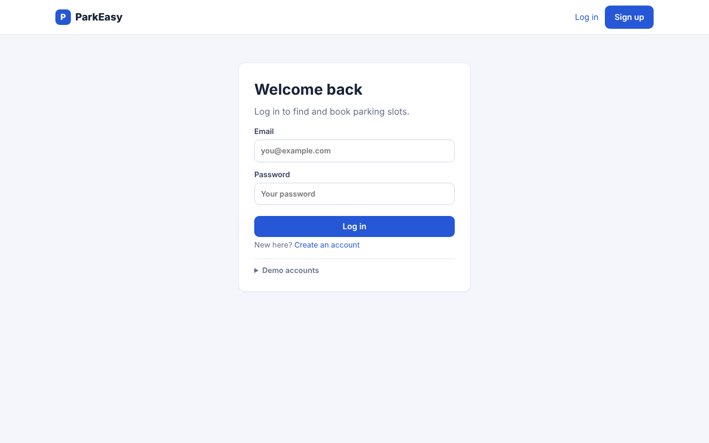
*Login page, with the demo accounts listed*

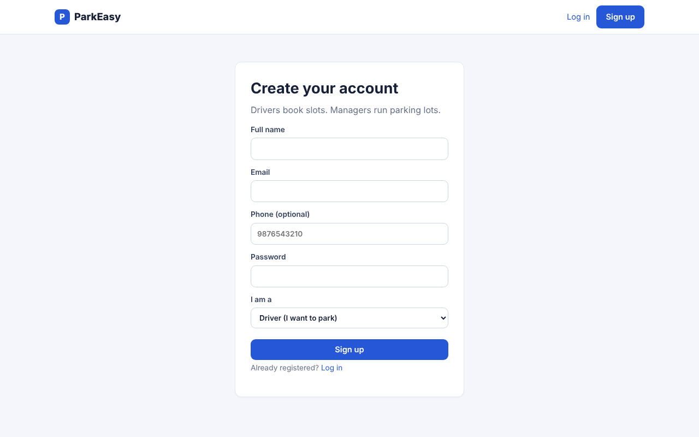
*Registration, where the user picks driver or lot manager*

### Driver

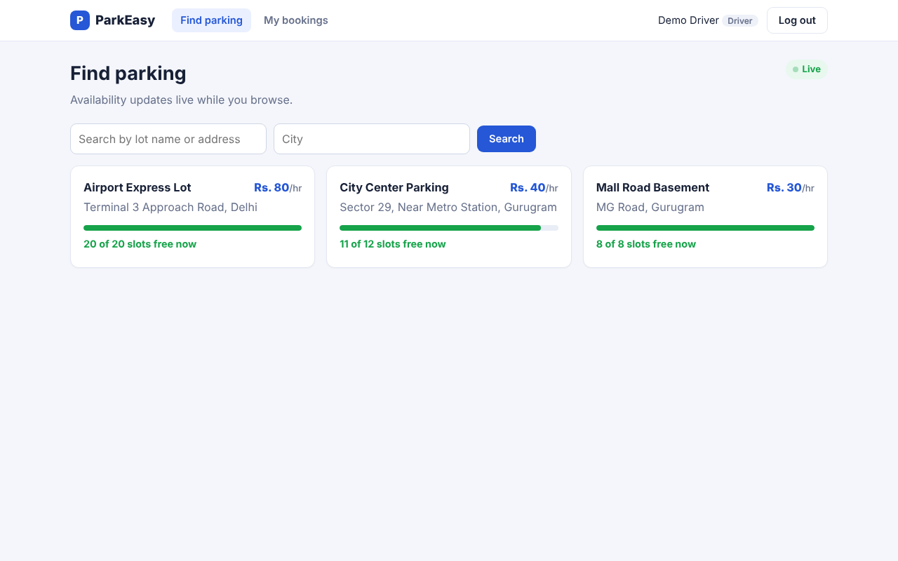
*Lot list with live free-slot counts*

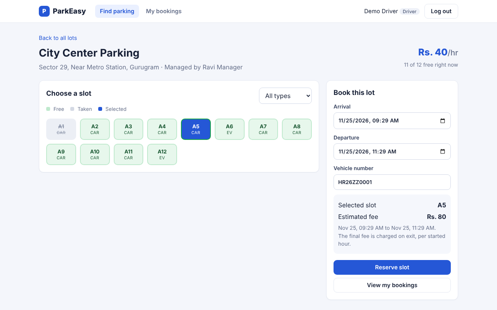
*Slot grid for the chosen time window. Taken slots are disabled, the estimated fee updates as the times change*

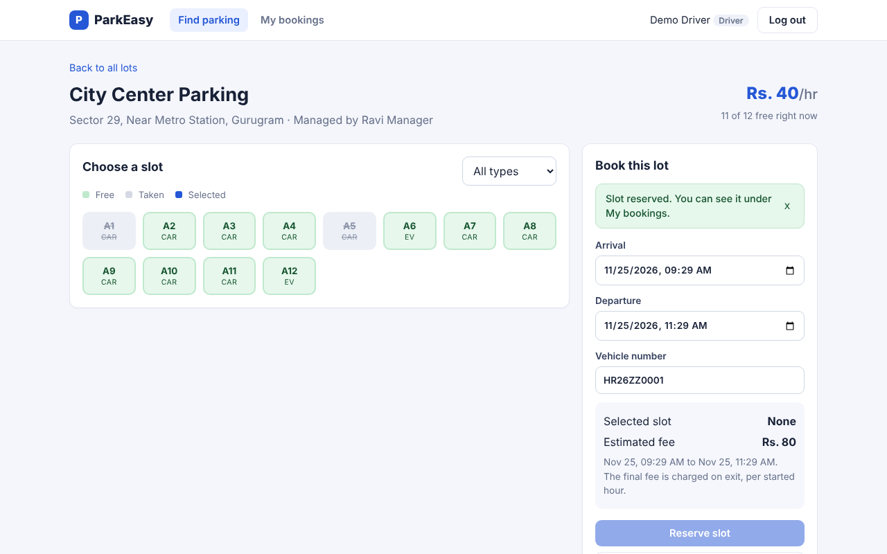
*After booking, the slot turns taken for that window*

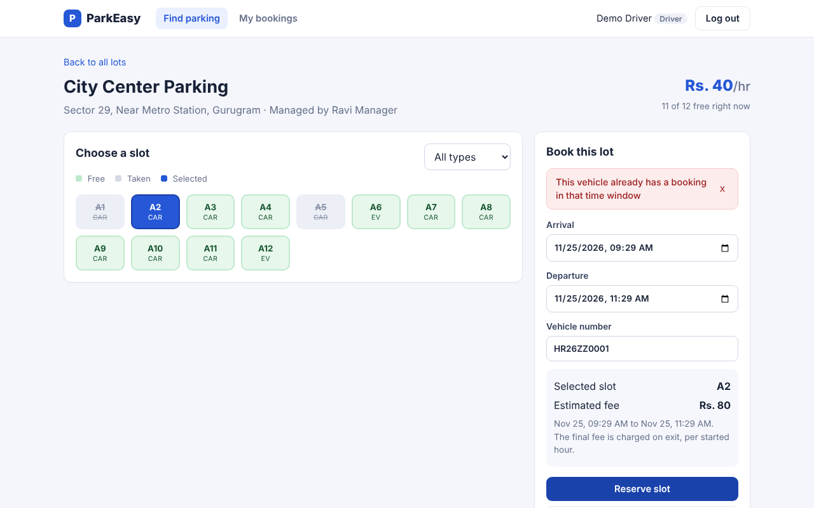
*The server rejects a second booking for the same vehicle in the same window*

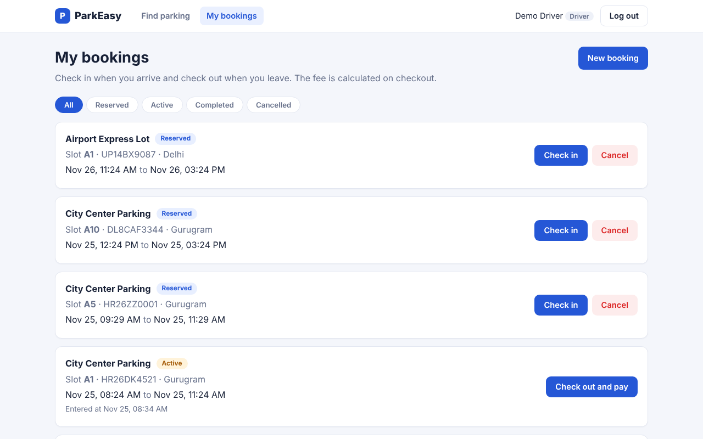
*Bookings with status filters, check in, cancel and check out*

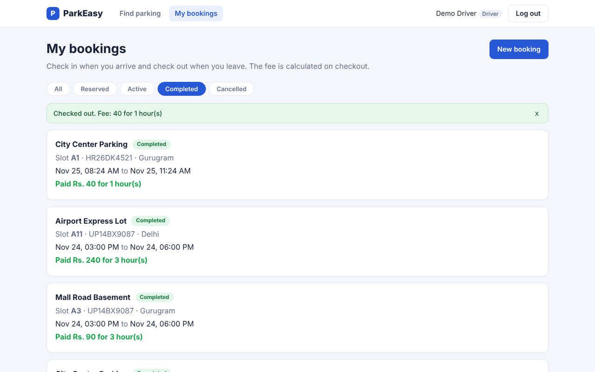
*Completed stay with the fee calculated on checkout*

### Lot manager

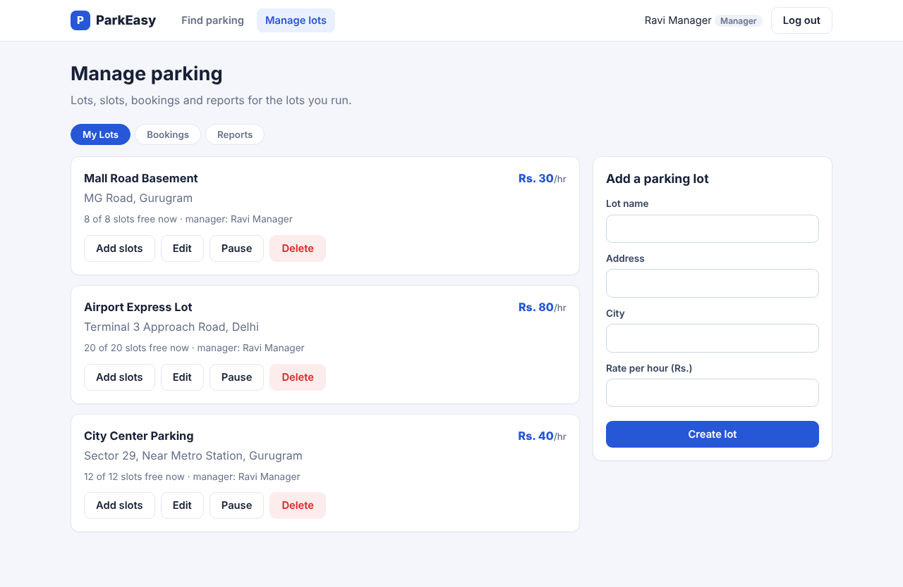
*Create lots, add slots in bulk, edit, pause or delete*

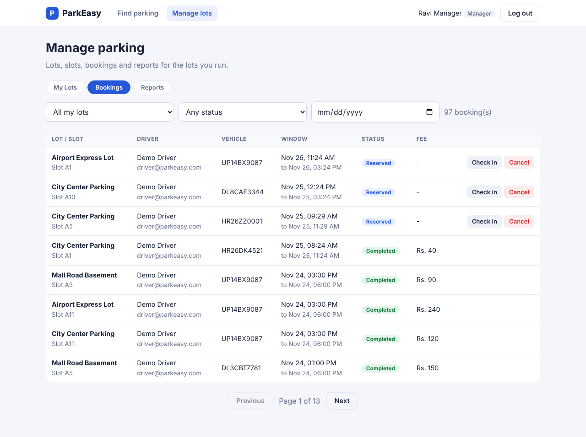
*Bookings across the manager's lots with filters and actions*

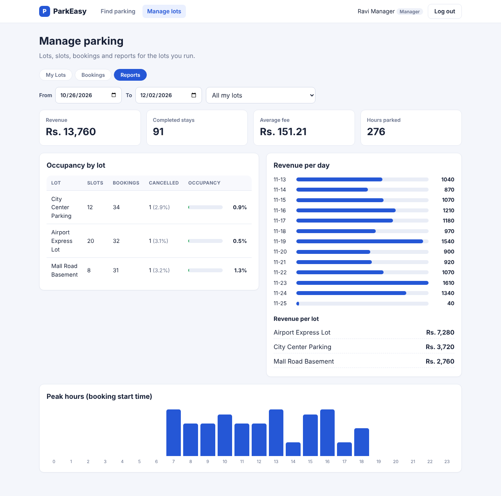
*Occupancy, revenue per day and per lot, and peak hours, all from aggregation pipelines*

### Admin

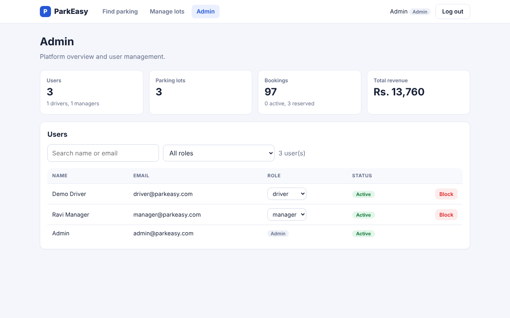
*Platform statistics and user management*

### Testing

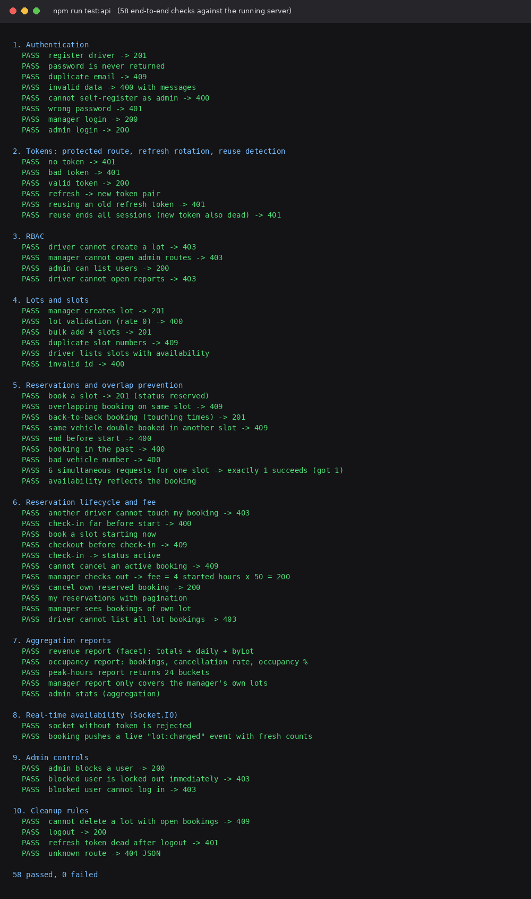
*Output of `npm run test:api`: 58 passed, 0 failed*

## Deployment

A typical free setup:

1. **Database:** create a MongoDB Atlas cluster and copy its connection string.
2. **Backend (Render, Railway or similar):** root directory `backend`, build command `npm install`, start command `npm start`. Set `MONGO_URI`, both JWT secrets, and `CLIENT_URL` to your frontend URL. Run `npm run seed` once against the Atlas database.
3. **Frontend (Vercel or Netlify):** root directory `frontend`, build command `npm run build`, output directory `dist`. Set `VITE_API_URL` to the backend URL. Add a rewrite of all paths to `/index.html` so React Router works on refresh.

Put the two links at the top of this README.

## Known limitations

- The booking lock works inside one server process. Running several backend instances would need a database-level guard, such as transactions on a replica set.
- Refresh tokens are kept in the browser's local storage for simplicity. An httpOnly cookie would be safer for production.
- Payments are not integrated. The fee is calculated and stored on checkout only.
- Reserved bookings that nobody checks in are not expired automatically; the manager or driver cancels them.
# Web-Dev-III-Capstone-Project
